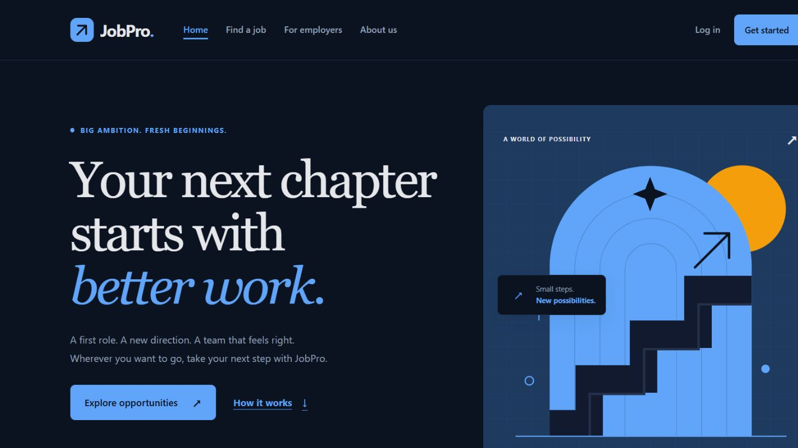

# JobPro

A job portal being modernized with **HTML, CSS, vanilla JavaScript, PHP, and MySQL**. Development follows a frontend-first, phase-by-phase process.

## Current milestone

Phase 1 implements the design foundation, responsive shared navigation/footer, and landing page. It includes the project blue/amber palette, automatic light/dark appearance, keyboard navigation, native FAQ disclosures, and a lightweight SVG illustration.

Existing PHP pages remain connected. Their layouts and backend workflows are being reviewed in later milestones; this is not yet a production-ready release.



## Local development on Windows

Requirements: PHP with mysqli/mysqlnd and DOM, a MySQL-compatible database, and Laravel Herd. No Laravel framework, Composer install, or npm build is required. DOM is used by the optional PHP checks.

1. Open this project in VS Code and start Herd and MySQL.
2. Check whether a database named `jobpro` already exists before importing `jobpro-4.sql`. The dump creates the database and includes sample records.
3. Configure `includes/dbconnect.php` with local credentials. Keep passwords private and review database sample data before publishing it.
4. For the current `D:\Projects\JobPro` folder and `/jobpro/` URL prefix, run in PowerShell:

   ```powershell
   Set-Location D:\Projects
   herd link jobpro-local
   ```

5. Open `http://jobpro-local.test/jobpro/index.php`.

The parent-directory mapping preserves the original application URLs. Configuration consolidation and deployment hardening are planned backend work.

## Checks

From the project directory:

```powershell
php tests/phase1.php
```

Optional JavaScript syntax check, if Node.js is installed:

```powershell
node --check assets/js/script.js
```

The shell checks do not connect to a database or log into a real account. See [Phase 1 implementation and verification](docs/phase-1.md) for scope, browser checks, known limitations, and manual GitHub steps.
