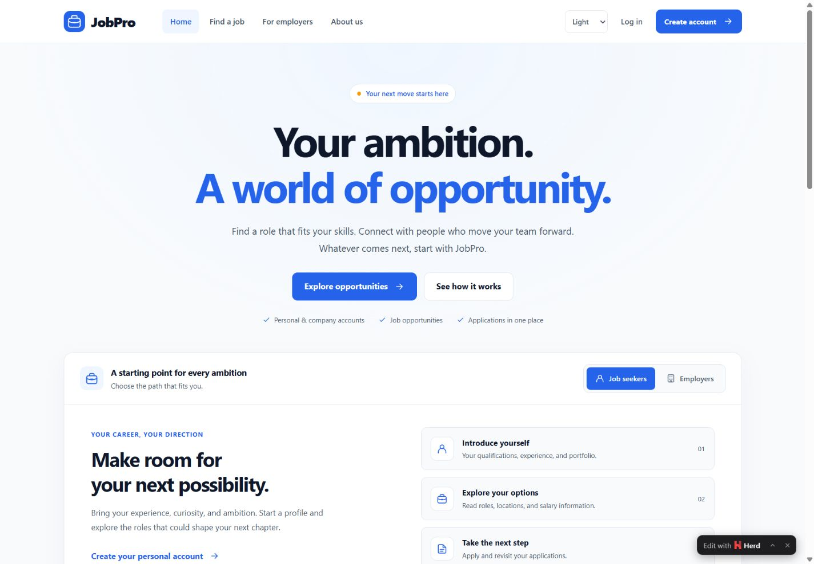

# JobPro

A job portal being modernized with **HTML, CSS, vanilla JavaScript, PHP, and MySQL**. Development follows a frontend-first, phase-by-phase process.

## Current milestone

Phase 1 provides the design foundation, responsive shared navigation/footer, and landing page. Phase 2 adds public discovery and job details using that foundation: keyword/location search, category/type/date filters, sorting, pagination, shareable URLs, and loading/empty/error states. Both milestones use the blue/amber palette and System/Light/Dark appearance controls.

Existing PHP pages remain connected. Their layouts and backend workflows are being reviewed in later milestones; this is not yet a production-ready release.

Open [job discovery](http://jobpro.test/pages/seekJob.php) for real database listings. The optional [design preview](http://jobpro.test/pages/seekJob.php?demo=1) uses clearly labeled fictional jobs, with applications disabled. The original application workflow remains available at `/pages/applications.php` after login. See [Phase 2 scope and verification](docs/phase-2.md).



## Local development on Windows

Requirements: PHP with mysqli/mysqlnd and DOM, MySQL, and Laravel Herd. No Laravel framework, Composer install, or npm build is required. DOM is used by the optional PHP checks.

1. Open Laravel Herd and start MySQL.
2. Link the existing **D:\Projects\JobPro** folder as **jobpro** in Herd. The site must point directly to the project, not to D:\Projects or to a generated preview folder.
3. Keep includes/dbconnect.php locally with your MySQL credentials. This private file is ignored by Git; it is required by database-dependent pages. Do not post its contents publicly.
4. Check whether the jobpro database exists before importing jobpro-4.sql. Do not import over an existing database without reviewing/backing it up.
5. Open **http://jobpro.test/**. The entry point redirects to **/pages/landing.php**.

The application now uses domain-root /pages/, /api/, and /assets/ URLs. Old database image URLs are normalized when listings are read, without changing database records. The entry redirect is absolute and is marked no-store so malformed /pages/pages/... addresses cannot keep extending it.

Do not use the former /jobpro/ prefix as the normal application URL. Existing account/application bugs remain separate from this startup correction. Deployment is postponed until the application is complete; deployment-only preview files have been removed.

## Checks

From the project directory:

```powershell
php tests/phase1.php
php tests/login.php
node tests/discovery.js
```

Optional JavaScript syntax check, if Node.js is installed:

```powershell
node --check assets/js/script.js
```

The shell and login unit checks do not connect to a database or log into a real account. An optional local integration test, `php tests/login-http.php --run`, requires MySQL and the running `jobpro.test` Herd site. It creates disposable personal/company accounts, tests login, session persistence, logout, and employer page access, then removes its test records. Do not run it against a production database. See [Phase 1 implementation and verification](docs/phase-1.md) for scope, browser checks, known limitations, and manual GitHub steps.

`php tests/discovery-http.php` checks the public discovery feed and page access through local Herd without database writes. Node is optional for running the discovery logic checks; the application itself has no Node runtime or build dependency.
